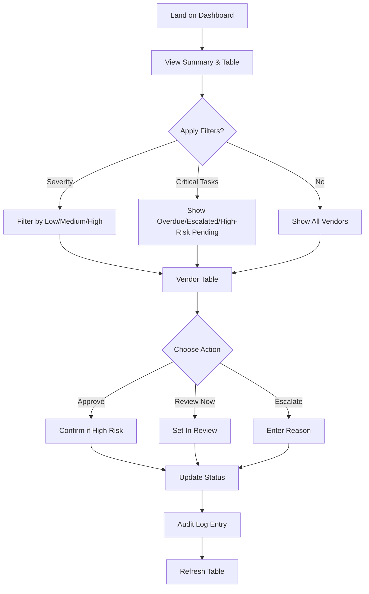
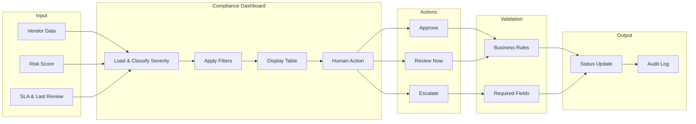

# Vendor Risk Scorecard – Detailed Spec (Compliance Team)

## 1. Overview & Goals

- **Purpose:** Single dashboard for the compliance team to see vendor risk, review status, SLA, and take actions (approve / review now / escalate).
- **Users:** Compliance analysts and reviewers.
- **Outcomes:** Clear risk visibility, consistent review workflow, SLA tracking, and human-in-the-loop decisions.

---

## 2. Data Model & Table Columns

### 2.1 Vendor Table (Main Scorecard)

| Column | Type | Description |
|--------|------|-------------|
| **Vendor Name** | `string` | Display name. |
| **Category** | `string` | e.g. Technology, Professional Services, Facilities. |
| **Sub Category** | `string` | e.g. Cloud Hosting, Legal, Cleaning. |
| **Risk Score** | `number` | 0–100 (higher = higher risk). |
| **Risk Details** | `string` | Short summary of risk factors (e.g. "Expired certs, no BCP"). |
| **Severity** | `'low' \| 'medium' \| 'high'` | Derived from risk score (see §3). |
| **Last Review Date** | `string` (ISO date) | Date of last compliance review. |
| **SLA** | `string` | e.g. "30 days", "90 days", "Annual". |
| **Status** | `'pending_review' \| 'approved' \| 'escalated' \| 'in_review'` | For human-in-the-loop. |

Optional: `id`, `createdAt`, `reviewedBy`, `escalationReason`.

### 2.2 Severity Rules (Updated)

- **Low:** Risk score **< 40** (0–39) → green badge.
- **Medium:** Risk score **40–70** (inclusive) → amber/orange badge.
- **High:** Risk score **> 70** (71–100) → red badge.

Badges: pill/chip style with text "Low" / "Medium" / "High".

---

## 3. Risk Category Buckets

Use for **filtering and grouping**:

- **By risk band:** Low (< 40), Medium (40–70), High (> 70).
- **By category:** Technology, Professional Services, Facilities, Operations, Finance, HR, Marketing, Other.
- **By status:** Pending review, In review, Approved, Escalated.
- **By SLA:** e.g. 30 days, 60 days, 90 days, Annual.

---

## 4. Filters

### 4.1 Severity Filter

- **Control:** Dropdown or chip group (multi-select or single).
- **Options:** Low, Medium, High, All.
- **Behavior:** Table shows only vendors whose severity matches selected value(s). Default: All.

### 4.2 Critical Tasks Filter

- **Control:** Toggle or checkbox: "Critical tasks only".
- **Definition of critical:** Vendors that meet **any** of:
  - **Overdue SLA:** Last review date + SLA period is in the past.
  - **Escalated:** Status = `escalated`.
  - **High risk + pending:** Severity = high AND status = `pending_review` or `in_review`.
- **Behavior:** When "Critical tasks only" is on, table shows only vendors in the critical set. Works in combination with Severity filter (and other filters).

---

## 5. User Flow Chart

---

## 6. Process Map

---

## 7. Human-in-the-Loop Review Logic

- **Approve:** Allowed for `pending_review` or `in_review`. Sets `status = 'approved'`. Optionally set `lastReviewDate = today`, `reviewedBy`. Do not auto-approve when risk score > 70 without confirmation (or require comment).
- **Review now:** Sets `status = 'in_review'`. Optional: open Review drawer/modal (comment, due date).
- **Escalate:** Sets `status = 'escalated'`. **Required:** escalation reason (validated). Store `escalationReason`, `escalatedAt`, `escalatedBy`. Escalated items appear in "Escalated" bucket.
- **Button visibility:** e.g. Show Approve + Review now + Escalate when `pending_review`; for `in_review` show Approve + Escalate; for `approved` show "Reviewed" or no actions. High severity + Approve → optional confirmation modal.

---

## 8. Audit Log

### 8.1 Purpose

- Record who did what, when, and (where relevant) why, for compliance and traceability.

### 8.2 Audit Log Model

| Field | Type | Description |
|-------|------|-------------|
| `id` | `string` | Unique log entry id. |
| `timestamp` | `string` (ISO datetime) | When the action occurred. |
| `actor` | `string` | User id or email (from auth/session). |
| `action` | `'approve' \| 'review_now' \| 'escalate' \| 'view' \| 'filter'` | Action type (at minimum: approve, review_now, escalate). |
| `vendorId` | `string` | Vendor (or vendor name) affected. |
| `vendorName` | `string` | Snapshot of vendor name at time of action. |
| `previousStatus` | `string` | Status before action. |
| `newStatus` | `string` | Status after action. |
| `details` | `string` (optional) | e.g. escalation reason, approval comment. |
| `metadata` | `object` (optional) | e.g. IP, user agent, filter state. |

### 8.3 When to Write

- **Approve:** One entry per approval (vendorId, previousStatus, newStatus = approved, actor, timestamp, optional details).
- **Review now:** One entry (newStatus = in_review).
- **Escalate:** One entry with `details` = escalation reason (required).

### 8.4 Retention & Access

- Retain audit log per org policy (e.g. 7 years). Read-only for compliance; no delete in UI. Optional: export audit log (CSV/JSON) for date range.

---

## 9. Validations

### 9.1 Client-Side

- **Escalate:** Escalation reason required, min length (e.g. 10 chars), max length (e.g. 500).
- **Filters:** Severity and critical-task filter values from allowed enums only.
- **Approve (high risk):** If risk score > 70, require confirmation (modal) before calling API.

### 9.2 Server-Side (API)

- **Approve:** Validate vendor exists; validate status is `pending_review` or `in_review`; optionally reject if risk score > threshold without comment.
- **Review now:** Validate vendor exists; validate status allows transition to `in_review`.
- **Escalate:** Validate vendor exists; validate `escalationReason` present and length within range; validate status allows escalation.
- **Audit log:** Ensure every state-changing action writes an audit log entry; validate `actor` from session/token.

### 9.3 Data Integrity

- Risk score 0–100; severity derived consistently (low < 40, medium 40–70, high > 70).
- Last review date and SLA: valid dates/periods; used for "overdue" in critical tasks.

---

## 10. Test Vendor Data (Sample)

Use types from §2. Severity computed: **low < 40, medium 40–70, high > 70**.

| id | vendorName | category | subCategory | riskScore | riskDetails | severity | lastReviewDate | sla | status |
|----|------------|----------|-------------|-----------|-------------|----------|----------------|-----|--------|
| 1 | Acme Cloud Inc | Technology | Cloud Hosting | 72 | Expired SOC2, no BCP | high | 2024-06-15 | 90 days | pending_review |
| 2 | Global Legal LLP | Professional Services | Legal | 28 | Minor contract gaps | low | 2025-01-10 | Annual | approved |
| 3 | Metro Facilities | Facilities | Cleaning | 55 | Pending insurance renewal | medium | 2024-09-01 | 60 days | in_review |
| 4 | DataFlow Analytics | Technology | Data Processing | 88 | No DPA, GDPR concerns | high | 2023-11-20 | 30 days | escalated |
| 5 | SecurePay Ltd | Finance | Payments | 45 | Audit findings open | medium | 2025-02-01 | 90 days | pending_review |
| 6 | Office Supplies Co | Operations | Procurement | 18 | No issues | low | 2025-02-28 | Annual | approved |
| 7 | DevTools Software | Technology | Software | 62 | Delayed penetration test | medium | 2024-08-12 | 60 days | pending_review |
| 8 | HealthFirst Partners | HR | Benefits | 78 | PHI handling review overdue | high | 2024-03-01 | 30 days | pending_review |

---

## 11. User Flows (Summary)

### 11.1 View & Filter

1. Land on Vendor Risk Scorecard.
2. See summary: total vendors, counts by severity (Low / Medium / High), Pending review, Escalated.
3. **Filters:** Severity (Low, Medium, High, All), **Critical tasks only** (overdue SLA, escalated, high-risk pending).
4. Apply filters → table updates.
5. Table: Vendor Name, Category, Sub Category, Risk Score, Risk Details, Severity (badges), Last Review Date, SLA, Action buttons. Sort by Risk Score (desc default), Last Review Date, Vendor Name.

### 11.2 Approve

1. Click **Approve** on a row. If risk score > 70 → confirmation modal.
2. Confirm → API sets `status = 'approved'`, optional `lastReviewDate`, `reviewedBy`. **Audit log:** action = approve, actor, timestamp, vendorId, previousStatus, newStatus.

### 11.3 Review Now

1. Click **Review now** → status = `in_review` (optional review modal). **Audit log:** action = review_now.

### 11.4 Escalate

1. Click **Escalate** → modal with required **Escalation reason** (validated length).
2. Submit → status = `escalated`, save reason. **Audit log:** action = escalate, details = reason.

### 11.5 CTAs

- **Primary:** "Review pending vendors" / "Start review" → focus Pending review or first pending row.
- **Secondary:** "View escalated", "Export" (current view).
- **Per row:** Approve | Review now | Escalate.

---

## 12. Tech Stack & UI

- **Stack:** Next.js (App Router), TypeScript, Tailwind.
- **Pages:** `/` or `/dashboard` (scorecard: summary, filters, table, actions). Optional: `/vendor/[id]`, `/audit-log`.
- **Components:** Layout, SummaryCards, **Filters (Severity + Critical tasks)**, VendorTable, SeverityBadge, ActionButtons, Modals (confirm approve, escalation reason), AuditLogView (optional).
- **API:** e.g. `GET /api/vendors`, `POST /api/vendors/[id]/approve`, `review`, `escalate`; `GET /api/audit-log` (optional). Persist vendors and audit log in DB (e.g. Supabase/Postgres).

---

## 13. Deliverables Checklist

- [ ] Types: `Vendor`, `Severity` (low < 40, medium 40–70, high > 70), `VendorStatus`.
- [ ] Test vendor data: 8+ rows; severity computed per new rules.
- [ ] **Filters:** Severity filter + Critical tasks filter.
- [ ] Scorecard table: all columns, severity badges, sort.
- [ ] Action buttons: Approve, Review now, Escalate with human-in-the-loop logic.
- [ ] Modals: confirm (high-risk approve), escalation reason with validation.
- [ ] **Audit log:** model, write on approve/review_now/escalate, optional UI/export.
- [ ] **Validations:** client + server for escalate; optional for approve/review; severity derivation.
- [ ] **User flow chart and process map** (e.g. Mermaid in this spec).
- [ ] Next.js, TypeScript, Tailwind.

---

## 14. Optional Enhancements

- SLA breach indicator (overdue) on table row.
- Export table and audit log (CSV/Excel).
- Search by vendor name or risk details.
